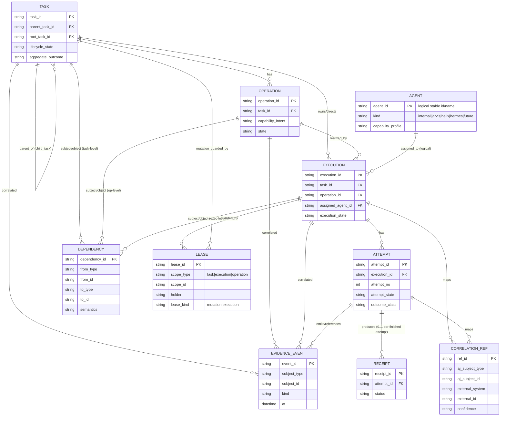

# 03 — Proposed Concurrent Domain Model (Stage 5A.1)

**Status:** **PROPOSED / NOT IMPLEMENTED / NOT APPROVED.** This document defines a minimal future model to support concurrent multi-task and multi-agent orchestration. It must not be read as current AJ behavior.

**Inputs:** Stage 5A.0 baseline (`00`, `01`), current-model audit (`02`), 4B.3/4B.5/4B.6 constraints (Hermes read-only/not attached, `gateway.ensure` unauthorized, NTFS/SQLite reliability caveat, 8 GB / 2C4T host, no JARVIS/HELIX/Hermes modifications).

---

## 1. Design goals and constraints
- Support **multiple simultaneous tasks** and **multiple concurrent executions per task** where safe/appropriate.
- Support **independent attempts/retries** with honest outcomes (no exactly-once external side effects).
- Preserve **parent/child, dependency, and evidence provenance**; survive process restarts.
- Keep AJ as orchestration/control plane; keep **Hermes runtime identity separate** from AJ orchestration identity; do not couple JARVIS personal memory or HELIX internal task state into AJ canonical task DB.
- Avoid unnecessary abstraction (no mandatory distributed DB/broker/Docker/paid services). Prefer additive evolution of existing primitives (task store, leases, journal, receipts, operation evidence).
- Respect 8 GB / 2C4T: model must enable bounded/resource-aware scheduling (designed later), not assume unbounded parallelism.

## 2. Conceptual entities (minimal set)

| Entity | Proposed role (stable vs transient) | Notes |
|---|---|---|
| **Task** | **Stable, user/logical unit of work** owned by AJ. Holds goal, requester/ownership, priority/policy context refs, parent/root lineage, dependency refs, aggregate lifecycle/outcome, and pointers to child tasks/operations/executions. | One task may own 0..N operations/executions over time. |
| **Operation** | **Stable planning/coordination unit** within a task (a scoped action/capability intent), when needed to separate "what is to be done" from runtime attempts. Optional/minimal for simple 1:1 tasks but required for multi-step/multi-execution tasks. | Avoids overloading `task.operation_id` for all concurrent work. |
| **Execution** | **Stable AJ-side record of one dispatchable execution instance** (assignment of an operation/task work item to an execution path/adapter/agent slot). Represents "an execution was requested/managed" with its own lifecycle and correlation. | Distinct from process handle; must survive restart as evidence/state. |
| **Attempt** | **Stable record of one concrete try** of an execution (or operation dispatch) including start/end, result, failure, evidence refs, and retry lineage. Retries create new attempts. | Enables independent retry without conflating execution identity. |
| **Agent** | **Stable logical agent capability/profile** (e.g. AJ internal, JARVIS, HELIX, Hermes-backed logical executor) plus optional **ephemeral worker/instance identity** at runtime. AJ tracks assignment eligibility/capabilities; runtime instance IDs are transient but referenced in attempts/evidence. | AJ must not assume live JARVIS/HELIX/Hermes integrations exist. |
| **Dependency** | **Stable relation** (edge) with typed semantics: task→task, operation→operation/execution prerequisites as required. Carries satisfaction/failure/cancel/unknown impact rules. | Must not confuse task dependency with execution dependency. |
| **Lease** | **Coordination/control record** (can be ephemeral with durable evidence) for exclusive mutation/execution ownership, heartbeat, and anti-duplication where reliable. | Evolves existing operation/execution lease separation. |
| **Event / Evidence** | **Append-only durable records** (journal events, receipts, operation evidence, audit refs) correlated by stable IDs. | Source of truth for what happened/what is unknown. |
| **Correlation** | **Cross-boundary linkage metadata** (AJ IDs ↔ external runtime/session/request IDs when honestly observed). | Never fabricated; external IDs remain external. |

## 3. Entity relationship diagram (proposed, Mermaid)

## 4. Identifier ownership and lifecycle (proposed)

| Identifier | Owner (AJ component/domain) | Stable? | Persistence | Purpose | Cardinality notes |
|---|---|---|---|---|---|
| `task_id` | AJ Task domain (`TaskStore`/task service) | Stable | Durable (canonical task record) | User/logical work unit; root correlation key | 1 per task; survives restart |
| `operation_id` | AJ Operation domain (scoped to task) | Stable | Durable | Scoped intent/work package within task | 0..N per task (1..N when operation modeling used) |
| `execution_id` | AJ Execution/orchestration domain | Stable | Durable | One managed execution instance/dispatch slot | 0..N per task/operation; key for concurrent executions |
| `attempt_id` | AJ Attempt/evidence domain | Stable | Durable (attempt record/receipt/journal refs) | One concrete try of an execution | 1..N per execution (retries/new tries) |
| `agent_id` (logical) | AJ Agent/capability registry domain | Stable | Durable config/registry metadata | Logical executor/profile identity | Reusable across executions; not instance-unique |
| `worker_instance_id` (runtime holder) | Runtime/scheduler/lease holder (ephemeral label) | Transient but recordable | Recorded in leases/events/attempts as evidence | Identify current holder/process/worker | May change across restarts/claims |
| `dependency_id` | AJ Dependency domain | Stable | Durable | Relation identity & semantics | N..M graph edges |
| `lease_id` | AJ Coordination/lease domain | Stable record id | Durable/evidenced | Ownership/mutation/execution guard instance | 0..N over time per scope |
| `correlation_id` / `correlation_ref` | AJ Correlation domain | Stable ref record; value may reference external | Durable | Link AJ entities to external/runtime IDs | 0..N; never fabricated |
| `event_id`, `receipt_id`, evidence IDs | AJ Evidence stores | Stable | Append-only durable | Audit/provenance | Many-to-one to subjects |

**Rule:** AJ orchestration IDs are authoritative in AJ; external runtime IDs are observational/correlational only unless explicitly contracted.

## 5. Proposed lifecycle model (separate from current)

### 5.1 Task lifecycle (aggregate, proposed)
`created -> validated -> admitted/queued -> active -> (waiting|blocked)* -> completing -> completed|failed|cancelled|rejected|unknown|requires_manual_review`

- **Aggregate semantics:** task completion means required child operations/executions satisfied per policy; task failure/cancel/unknown reflects aggregate evaluation with honest uncertainty.
- **Must not assume:** child completion implied by task state without evidence; external cancellation implied by local cancel.

### 5.2 Operation lifecycle (proposed, optional/minimal)
`planned -> ready -> in_progress -> satisfied|failed|blocked|cancelled|unknown`

- Groups intent/capability work; may map 1:1 with simple tasks.

### 5.3 Execution lifecycle (proposed)
`pending -> scheduled/admitted -> assigned -> dispatching -> running -> verifying -> succeeded|failed|cancelled|timed_out|lost|unknown|requires_manual_review`

- `lost/unknown` required for restart/ambiguity cases. Assignment binds to logical `agent_id` and records runtime holder/correlation evidence.

### 5.4 Attempt lifecycle (proposed)
`created -> started -> running -> succeeded|failed|cancelled|timed_out|abandoned|unknown`

- New retry => new `attempt_id` (and possibly new execution dispatch per policy), preserving lineage.

### 5.5 Dependency semantics (proposed)
- Typed edges (task/op/exec) with states: `unsatisfied|satisfied|failed|cancelled|unknown`.
- Propagation policy explicit: e.g. required dependency failed => dependent blocked/failed per rule; `RECOVERY_REQUIRED/unknown` dependency => dependent `blocked` or `requires_manual_review` (no silent proceed).

### 5.6 Cancellation and recovery (proposed)
- **Cancellation:** request scoped to task/operation/execution; records intent and observed effect; distinguishes local stop vs remote/runtime cancellation (often unknown).
- **Recovery:** evidence-driven reconciliation per execution/attempt; ambiguous external outcomes -> `unknown/requires_manual_review`, never fabricated success.

## 6. Relationship cardinalities (proposed)
- Task 1 — 0..N Task (children)
- Task 1 — 0..N Operation
- Task/Operation 1 — 0..N Execution
- Execution 1 — 1..N Attempt (over time)
- Logical Agent 1 — 0..N Execution assignments (concurrent, bounded by policy)
- Task/Operation/Execution — 0..N Dependencies (as subject/object)
- Execution/Attempt — 0..N Evidence events/receipts/correlation refs
- Scope (task/execution) — 0..N Leases over time (with exclusivity rules per kind)

## 7. Current vs proposed (distinction)

| Area | Current (verified/observed) | Proposed (future) |
|---|---|---|
| Execution identity | Implicit; no `execution_id` | First-class durable `execution_id` |
| Operation modeling | Single `operation_id` field on task | Explicit operation records when needed (0..N/task) |
| Attempts | Counter + `attempts[]`/receipts, partially conventional | First-class attempt entity/lineage per execution |
| Agent | Logical adapter/name; no instance lifecycle | Logical agent + recorded runtime worker/instance evidence |
| Dependencies | Task-level `depends_on` + `BLOCKED` checks | Typed dependency graph with explicit semantics/states |
| Concurrency | Basic scheduler threads possible; no orchestration model | Bounded concurrent executions with admission/resource policy (5A.2+) |
| Cross-store consistency | No ACID across stores; append-only primitives | Same pragmatic approach + stronger correlation/evidence contracts; no distributed DB by default |
| External runtime | Hermes read-only not attached; no lifecycle control | Correlation refs to external IDs when honestly observed; AJ identity remains separate |

## 8. Trade-offs and limitations
- **Minimalism vs expressiveness:** separate Execution/Attempt/Operation entities improve clarity for concurrency but add schema/logic complexity; mitigate by making Operation optional for simple cases and reusing existing evidence stores.
- **Durability vs NTFS/SQLite risk:** more durable records increase write pressure on unreliable storage; requires storage posture (4B.6/5A.4) and careful append patterns, but cannot guarantee reliability on current NTFS/WAL path.
- **No exactly-once:** design can reduce duplicates (leases/idempotency/correlation) but must represent `unknown` outcomes honestly.
- **8 GB host:** model supports bounded parallelism metadata but capacity is enforced by scheduler/admission (later stage), not by domain entities alone.
- **Compatibility:** should extend (not break) existing task/journal/receipt/lease semantics where feasible to preserve auditability and current behavior.

## 9. Explicit non-decisions in this stage
- No scheduler algorithm, queueing policy, worker-pool implementation, admission/resource manager, or runtime implementation chosen/implemented here.
- No database/schema migration executed; persistence layout changes are proposals only.
