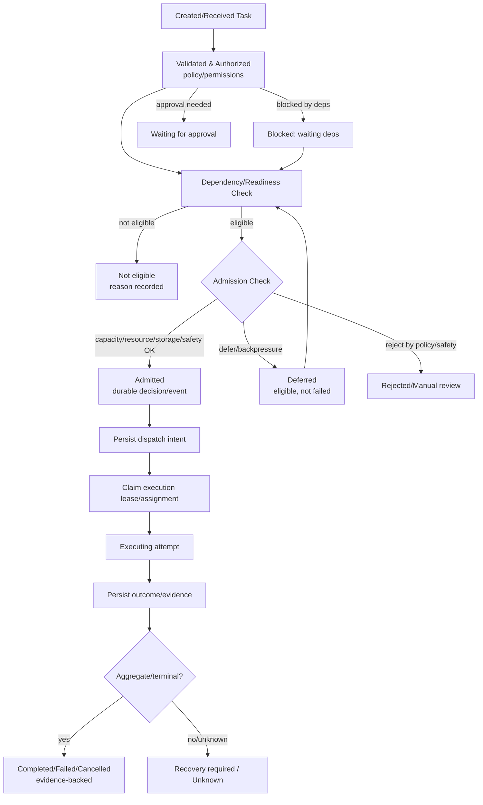
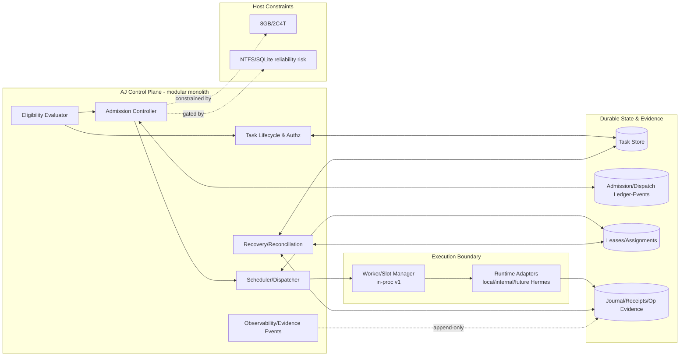
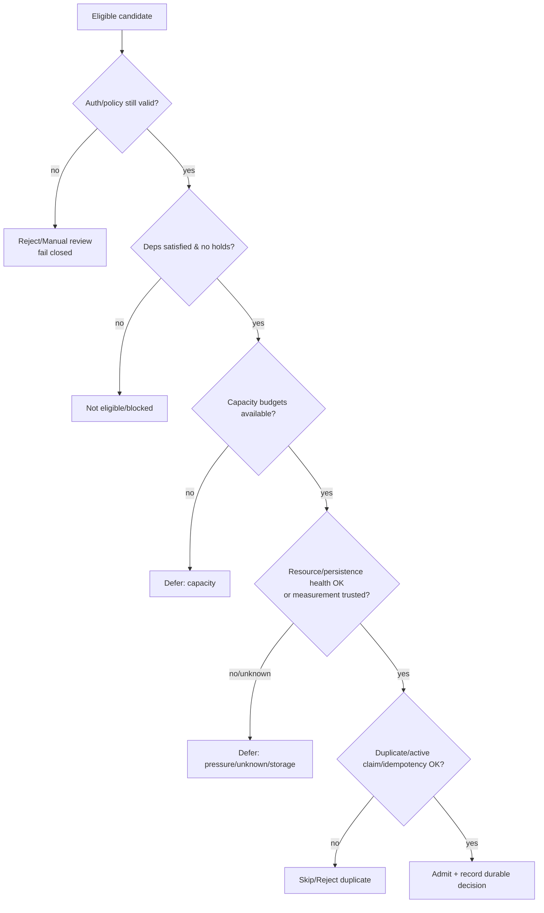
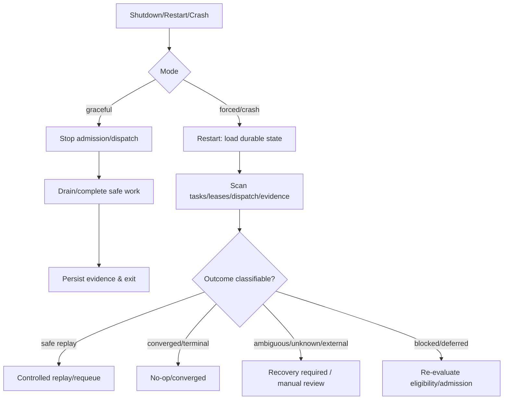

# 07 — Proposed Scheduler, Admission & Resource Architecture (Stage 5A.2)

**Status:** **PROPOSED / NOT IMPLEMENTED / NOT APPROVED.** Architecture audit/design only. No scheduler implementation, no DB/schema/config/flag changes, no runtime experiments/load tests, no Hermes lifecycle actions.  
**Inputs:** `00`–`06`, 4B.3/4B.4/4B.5/4B.6 constraints, `aj/scheduler.py`/task/orchestrator/lease/recovery current behavior, 8 GB / 2C4T (Dell Latitude 5480, i5-7300U, Intel HD 620, Ubuntu 26.04.1 GNOME Wayland, no local LLMs/Docker/paid APIs), NTFS-backed workspace with unresolved intermittent SQLite/WAL `disk I/O error` risk.

**Design constraints (must hold):** modular monolith, ports/adapters, explicit capabilities/permissions/feature flags, append-only durable evidence, fail-closed auth/lifecycle/recovery/reconciliation, idempotency/auditability, replaceable adapters, deny-by-default; no new DB/broker/distributed-coordination/recovery-execution engines by default; no cross-store atomicity/exactly-once/authenticated identity/semantic health claims without evidence; AJ/Hermes boundaries unchanged (`hermes.status.read` only, NOT ATTACHED, `gateway.ensure` unauthorized).

---

## 1. Scheduler and control-plane responsibilities (proposed separation)

| Component | Responsibilities (proposed) | Must NOT do |
|---|---|---|
| **Task lifecycle / orchestrator** | Create/validate/authorize tasks, persist task intent/state, enforce permissions/approvals/policy, own dependency semantics at task level, record evidence, expose explicit transitions. | Treat authorization as capacity admission; execute unsafely without recorded intent; conflate task/execution/worker identities. |
| **Eligibility evaluator** (logical) | Determine whether a task/execution unit is *eligible* based on durable task state, dependency satisfaction, authorization/policy validity, deadline/cancellation, and recovery/manual-review status. Read-only evaluation over evidence/state. | Dispatch work; mutate unrelated state; guess missing evidence. |
| **Admission controller** (distinct layer) | Decide whether an *eligible* unit may be *admitted* now given capacity, resource budgets/pressure, persistence health, concurrency limits, fairness/priority policy, and safety gates. Emit durable admission decision/evidence (accepted/deferred/rejected with reason). | Create/authorize tasks; execute work; represent waiting-for-capacity as failure/cancellation. |
| **Scheduler / dispatcher** | Select among *admitted* work per policy (priority/fairness/deadline/dependency-aware), claim execution ownership (lease/dispatch intent) only when durable preconditions satisfied, hand off to execution boundary, track dispatch outcomes. | Bypass admission/permissions; assume resource availability; claim exactly-once. |
| **Execution / worker boundary** | Run admitted-dispatched execution under owned lease/identity, report progress/outcome/evidence, honor cancellation/timeout signals where possible, isolate runtime-specific concerns. | Own task authorization/admission policy; mutate canonical task graph arbitrarily; imply remote cancellation by local stop. |
| **Recovery/reconciliation** | Assess interrupted/ambiguous work from durable evidence, classify replay-safe vs manual-review/unknown, converge state conservatively, prevent unsafe duplicate external effects where detectable. | Fabricate outcomes/IDs; auto-replay unsafe/ambiguous external actions. |

**Key separations:** Task lifecycle ≠ admission decision ≠ execution lifecycle ≠ worker lifecycle. Admission is a *capacity/safety gate* between eligibility and dispatch, not a task state and not authorization.

---

## 2. Proposed pipeline (conceptual, labeled PROPOSED)

**PROPOSED pipeline (eligibility → admission → dispatch → execution → evidence/recovery):**

`Created/Received → Validated/Planned → Authorized (policy/permission) → Dependency/Readiness Check → **Eligible** → **Admission Check** (capacity + resource + persistence + safety) → **Admitted/Queued-for-dispatch** (or Deferred/Backpressured/Rejected-with-reason) → **Dispatch Intent Persisted** → **Execution Lease/Assignment Claimed** → **Executing** → **Attempt/Execution Outcome Persisted** → (Verifying/Aggregating) → Terminal/Aggregate or Recovery-Required/Unknown`

- **Eligibility** answers: "is this work allowed and ready to run in principle?" (state, deps satisfied, not cancelled, auth/context valid, not manual-review-blocked).
- **Admission** answers: "is it safe and within budget to run it now?" (slots, resource class budget, pressure/storage health, rate limits).
- **Dispatch** answers: "who/which execution instance owns this run now?" (durable dispatch intent + lease/assignment).
- **Execution** answers: "what happened in this attempt/execution?" (evidence, receipts, unknown/timeout outcomes).

**Admission representation (recommended, minimal):** do not force a new durable `ADMITTED` task status initially. Prefer **append-only admission decision records/events** (and/or a lightweight admission ledger) correlated to `task_id`/future `execution_id`, with reason codes and expiry/reevaluation semantics. A transient in-memory admission set may exist but **durable intent/evidence must exist before dispatch** when required for safety. (Alternative of explicit task state is possible later but mixes lifecycle concerns; see alternatives.)

---

## 3. Admission-control architecture (proposed)

### 3.1 Conditions for eligibility (all required, evidence-based)
- Task/execution unit in a dispatchable lifecycle state per policy (e.g. authorized/ready/retry-eligible), not terminal, not cancelled/aborted.
- Authorization/permission context valid and not stale/materially changed for consequential work (fail closed on ambiguity).
- Dependencies satisfied per typed semantics (task/op/execution as applicable): unsatisfied/missing/cyclic/failed/unknown/recovery-required dependencies block eligibility or route to blocked/manual-review per rule.
- Deadlines/TTL/scheduling windows permit execution (overdue behavior explicit: defer, expire, or manual-review — never silent success).
- No unresolved recovery/manual-review hold requiring operator decision.
- Required capability/runtime/adapter available *at policy level* (honest availability; unavailable ⇒ ineligible or deferred with reason).

### 3.2 Conditions for admission (eligible + all required)
- **Capacity available:** within global and scoped concurrency budgets (see §4).
- **Resource budget available:** resource class budget/pressure gate permits (see §5).
- **Persistence/evidence safety:** system can reliably record required durable intent/evidence before/at dispatch; if storage health is unknown/unhealthy for required writes, **fail closed / defer admission** (no dispatch when durable intent cannot be recorded).
- **No duplicate-active admission/dispatch:** no valid active execution lease/assignment for the same execution unit; idempotency/dispatch-key checks pass.
- **Policy/rate limits satisfied:** retries/backoff, per-capability/per-agent limits, fairness quotas not violated.

### 3.3 Behavior when eligible but capacity unavailable
- Task remains **eligible but not admitted** (deferred/backpressured), **not failed**. Record append-only admission-deferred event with reason (`capacity`, `resource_pressure`, `storage_unhealthy`, `rate_limited`, etc.), timestamp, and next-reevaluation hint if known.
- Reevaluate on: scheduler tick/event, capacity release, dependency/completion events, resource-pressure change, or operator action. Avoid busy-spin.

### 3.4 Admission revocation/delay, batching, duplicates
- **Delay:** default response to temporary capacity/resource pressure.
- **Revocation:** allowed before durable dispatch claim if conditions change (cancellation, policy invalidation, pressure critical) — must emit evidence.
- **Batching:** optional future optimization; first version should admit incrementally with deterministic ordering to limit overcommit/races.
- **Duplicate prevention:** durable dispatch intent + per-execution-unit lease/assignment keyed by stable IDs; reject/skip if active owner/dispatch exists; reconcile on restart. **No exactly-once guarantee.**

### 3.5 Permissions/capabilities, deadlines/priority, unreliable measurements
- Permissions/approvals affect **eligibility/authorization**, not bypassable by admission; admission may additionally enforce capability-scoped limits.
- Deadlines/priority influence ordering and (optionally) admission preference/aging, but **must not override safety gates** (storage unhealthy, no capacity, permission invalid).
- If resource measurements are unavailable/unreliable, **fail closed for admission of non-trivial work** (defer with `measurement_unavailable`) or allow only explicitly classified minimal-safe work under strict global cap; never assume healthy.

---

## 4. Concurrency and capacity model (proposed, simplest safe evolution)

### 4.1 Recommended model: **hierarchical static budgets + conservative backpressure hooks** (first version)
Combine (1) global concurrency limit with (2) scoped limits and (3) a small resource-class budget map. Defer dynamic/telemetry-driven auto-tuning until reliable measurements exist.

| Limit | Problem controlled | Scope | Configurable | Static/dynamic (v1) | If measurement missing | Starvation/overload handling |
|---|---|---|---|---|---|---|
| `global_max_active_executions` | Total in-flight work on 8 GB host | Global | Yes (bounded defaults) | Static | N/A (count-based) | Hard cap; fair selection within admitted set |
| `global_max_admitted_waiting` (or dispatch queue bound) | Memory/state growth, overcommit | Global | Yes | Static | N/A | Bounded backlog; defer new admissions with backpressure reason |
| `max_active_per_task` | Fan-out explosion per logical task | Per task | Yes | Static | N/A | Queue remaining child executions; aggregate by policy |
| `max_active_per_capability` | Hotspot/unsafe capability saturation | Per capability | Yes | Static | N/A | Prevents one capability class starving others |
| `max_active_per_agent/runtime` (future-compatible) | External runtime/agent saturation | Per logical agent/runtime | Yes | Static (placeholders now) | Treat as 0/blocked if unknown adapter | Protects unavailable/attached boundaries (Hermes remains NOT ATTACHED) |
| `max_active_per_resource_class` | Coexistence of heavy/light work | Per resource class | Yes | Static | Default to most restrictive class | Ensures lightweight control work can proceed |
| `max_retries` / `retry_rate` / backoff | Retry storms, duplicate-risk amplification | Per task/capability | Yes | Static policy | N/A | Bounded retries; escalate/manual-review on ambiguity |
| `dispatch/acquire timeout` & lease TTL policy | Stuck claims, orphan detection window | Per execution | Yes | Static (tunable later) | Conservative defaults | Enables recovery assessment; never auto-unsafe replay |
| `max_pending_child_work` | Unbounded fan-out bookkeeping | Per parent/task | Yes | Static | N/A | Defer child creation/admission |

**No arbitrary numeric defaults proposed here** (values require benchmarking/policy approval; 8 GB/2C4T implies very small global concurrency, likely 1–2 by default for non-trivial work, but this is a **PROPOSED starting point, unverified**).

### 4.2 Resource classes (proposed taxonomy, evolve over time)
- `control_plane_light`: routing/eligibility/admission decisions, metadata/evidence appends, health reads.
- `local_io_moderate`: local file/task-store/journal operations (NTFS-sensitive).
- `sqlite_sensitive`: memory/SQLite-touching operations (subject to WAL/NTFS risk).
- `external_runtime_unknown`: Hermes/external agent dispatch (currently unavailable/not attached; treat as highest uncertainty).
- `cpu_memory_heavy`: future compute-heavy/large-context work (none intended now; reserve class).

Admission maps each execution unit to a resource class (and capability) before dispatch.

---

## 5. Wick hardware and resource-aware scheduling (proposed)

### 5.1 Resource dimensions and signals (historical observations, verify read-only before use)
- **Memory/swap:** available RAM, pressure/oom risk, swap activity (admission must stop before critical pressure; running work may continue unless explicit safe-cancel supported).
- **CPU:** load/available cores (2C4T) — avoid oversubscription that stalls control plane/evidence writes.
- **Disk:** free space on root and data/workspace paths; growth of logs/journal/receipts/tasks/memory DB.
- **Disk I/O / FS health:** especially NTFS-backed paths; write latency/error indicators.
- **Persistence health:** task-store append/journal/receipt/lease/SQLite probe outcomes (classified, read-only diagnostics) — **gating signal for admission/dispatch**.
- **Runtime/process counts:** active executions, subprocesses, queued/admitted backlog.
- **Network/runtime dependencies:** relevant for external runtimes (future; Hermes currently NOT ATTACHED).

### 5.2 Monitoring mode and response (proposed)
- **Hybrid:** lightweight periodic sampling (coarse) + event-driven reevaluation on admission/dispatch completion/failure/pressure transitions. Avoid tight polling on 2C4T.
- **Resource probe failure/unreliable:** treat as **pressure/unknown** → fail closed for new admissions of non-control work; emit evidence/diagnostic event.
- **Low RAM / swap pressure rising:** stop admitting new non-essential work; prefer completing/monitoring active work; never preempt unsafely.
- **Disk low / persistence unavailable or failing:** **block admission/dispatch requiring durable writes**; preserve/flush evidence opportunistically; no silent discard. If cannot record dispatch intent/outcome, transition affected work to recovery-required/unknown per evidence (not success).
- **SQLite/NTFS issues:** do not assume WAL reliability; degrade to conservative mode (serialize SQLite-sensitive admissions, or pause them) based on diagnostics; never claim correctness.

### 5.3 Storage safety (mandatory)
- Do not assume SQLite WAL reliable on current NTFS-backed workspace; do not make critical guarantees depend on unverified storage behavior.
- **Before dispatch:** persist minimum required durable intent (task/execution/dispatch/admission correlation + idempotency context) as applicable; if this fails, **do not dispatch** and fail closed with evidence.
- **Ambiguous outcomes:** recover via evidence reconciliation (`unknown/recovery_required/manual_review`) — no automatic unsafe retry, no silent discard.
- No storage relocation/mount/filesystem repair actions in design execution.

---

## 6. Priority, fairness, and starvation (proposed)

| Policy | Pros | Cons/trade-offs for AJ | Recommendation |
|---|---|---|---|
| FIFO | Simple, predictable | Head-of-line blocking by long/blocked work; poor for deadlines/urgency | Baseline within same class only |
| Static priority queue | Urgent work first | Starvation of low priority; easy to misuse | Useful input, not alone |
| Weighted priority / quotas | Balances classes (user vs background vs maintenance) | More parameters/tuning | **Recommended evolution** (small fixed classes) |
| Earliest-deadline-first (EDF) | Deadline-aware | Can starve non-deadline work; needs reliable deadlines | Optional constrained use; not global default v1 |
| Aging (priority boost over wait time) | Prevents starvation | Complexity; needs persisted wait/age evidence | **Recommended add-on** once admission records exist |
| Round-robin/fair-share by task/agent | Prevents one parent/task monopolizing | May delay urgent single work | Consider per-task/per-capability fairness caps |
| Dependency-aware priority (critical path/unblock) | Improves throughput | Graph complexity, cycle/unknown handling | Limited heuristic later; deps are correctness gates first |

**Practical first version (recommended):** bounded **priority bands** (e.g. user-interactive/urgent, normal, background) + **FIFO within band** + **per-task/per-capability concurrency caps** + simple **aging/anti-starvation floor** after wait threshold; deadlines as ordering hint/gate, not hard EDF initially. Keep policy deterministic and evidence-logged.

**Considerations:** urgent user requests prioritized but still admission/resource-gated; long-running work isolated by resource class/caps; background/maintenance lowest band; multiple users/tasks get fair-share caps; child tasks limited per parent; repeated failures trigger backoff/cap/review (not infinite requeue); external-runtime waits represented as waiting/unknown states (no slot burn without policy); resource-intensive tasks in restricted class.

---

## 7. Dependencies and scheduling interaction (proposed, aligned with 5A.1)

- **Types (future-compatible):** distinguish task dependencies, parent/child aggregation, and (when modeled) operation/execution dependencies. **Do not confuse task dependency with execution dependency.**
- **Eligibility rule:** a dependent unit becomes eligible only when required dependencies are **satisfied with evidence** per edge semantics. `FAILED/CANCELLED/DEAD_LETTER/RECOVERY_REQUIRED/unknown` dependencies block, fail, or route to manual-review per explicit policy — never silently treated as satisfied.
- **Cycles:** cycle detection required before/at eligibility evaluation for relevant graph scope; cyclic dependencies are invalid/blocked (not runnable).
- **Parent/child:** parent completion is an **aggregate** decision over required child executions/operations (policy-driven), not implied by dispatch. Support independent children running concurrently (bounded), partial completion, and fail/unknown propagation per policy.
- **Deadlines:** may propagate or constrain children as policy metadata; propagation must be explicit and evidence-backed.
- **Current state:** `unsatisfied_dependencies` provides task-level checks including cycle detection over inspected dep set and `COMPLETED` requirement (`aj/orchestrator.py`); full graph engine/event-driven reevaluation/admission integration is **proposed, not implemented**.

---

## 8. Scheduler monitoring and observability (proposed minimum)

**Distinguish durable facts (persisted/evidence-backed) from transient process-local metrics.**

| Metric / view | Type | Notes |
|---|---|---|
| Total pending/known tasks by lifecycle state | Durable (derived from task store) | Current capability exists partially via task queries. |
| Eligible tasks (and reasons not eligible) | Derived; decision events durable if logged | Proposed admission/eligibility events. |
| Admitted-but-not-dispatched / deferred (with reasons) | Durable if admission ledger/events implemented | **Proposed**; not currently collected. |
| Running executions / active leases/assignments | Durable lease/dispatch records + transient liveness | Leases exist (durable files) but execution identity incomplete. |
| Capacity available/reserved by scope/class | Derived/transient unless snapshotted | **Proposed**. |
| Blocked by dependencies / waiting for resources / delayed by permissions | Durable reasons (task state/events + admission events) | Partially representable today (BLOCKED, reasons) but not unified. |
| Rejected by admission control / rate-limited / backpressured | Durable events | **Proposed**. |
| Expired/stale leases, tasks requiring manual review/unknown | Durable (leases/recovery/evidence) | Partially available. |
| Resource pressure / persistence health signals | Transient snapshots + durable diagnostic events | **Proposed**; diagnostics exist read-only but not scheduler-integrated. |
| Scheduler health, last successful cycle, last failure + evidence | Durable journal/event records + transient heartbeat | **Proposed**. |

No UI/dashboard in scope; define append-only event/data fields for future inspection. **Do not invent metrics AJ cannot currently collect; mark as proposed.**

---

## 9. Shutdown, restart, and recovery behavior (proposed)

| Scenario | Required behavior (proposed) |
|---|---|
| Graceful shutdown, no active work | Stop admission/dispatch, flush/persist evidence, exit cleanly. |
| Graceful shutdown with active executions | Stop admitting new work; signal cooperative cancellation/timeout where supported; allow safe completion window if bounded; persist state/evidence; mark remaining as interrupted/unknown as appropriate. |
| Forced termination / machine reboot | No guarantee of graceful cleanup. On restart: load durable state, reconcile leases/dispatches/attempts, classify outcomes from evidence (converged/replay-safe/blocked/unknown/manual-review). |
| Expired task/execution lease | Treat as ownership uncertainty; do **not** authorize mutation/execution continuation solely due to expiry. Recovery assessment required; renew only if ownership/evidence valid per rules. |
| Worker crash | Release/expire ownership eventually; reconcile execution/attempt as failed-or-unknown based on evidence; reschedule only if proven safe and idempotent/replay-safe. |
| Persistence failure | Fail closed: do not dispatch without durable intent; do not mark success; preserve in-memory evidence best-effort only as non-authoritative; surface `recovery_required/storage_unhealthy`. |
| Resource pressure during recovery | Prioritize reconciliation/control-plane safety; throttle/defer replay/admission. |
| Multiple AJ processes restarting together | Use file locks/leases/atomic writes/idempotency keys and evidence reconciliation to avoid duplicate unsafe recovery actions; accept conservative blocking/manual-review on contention ambiguity. |
| External execution outcome unknown | Record `unknown/requires_manual_review/lost` with evidence; **never auto-retry** side-effecting external actions without proof of safety; never equate local process death with remote stop. |

**Persist before dispatch:** task/execution identity correlation, admission/dispatch intent, authorization/context snapshot as required, idempotency/dispatch key, and lease/assignment claim evidence (minimum viable durable record). **Process-local only:** thread handles, in-memory queues, transient metrics, live sockets/process objects. **Never claim exactly-once external execution.**

---

## 10. Architecture alternatives (>=4), comparison and recommendation

**All options below are PROPOSED (not current implementation).** All must preserve current boundaries, fail-closed behavior, append-only evidence, and 8 GB/NTFS constraints.

### Option A — Improved single-process scheduler (evolved in-place)
- **Description:** Keep single-process orchestrator/scheduler loop; add explicit eligibility/admission modules, durable admission/dispatch events, bounded in-process worker slots, resource-class budgets, and better lease/heartbeat/recovery integration.
- **Reliability:** Moderate if carefully designed (fewer moving parts) but single process is SPOF; crash loses in-flight context.
- **Concurrency:** Limited-to-moderate (threads/async slots) bounded by host.
- **Resource cost:** Lowest.
- **Complexity:** Low–moderate incremental evolution from `aj/scheduler.py`.
- **Persistence requirements:** Extend existing append-only stores/events; durable dispatch/admission records needed.
- **Recovery behavior:** Simpler centralized reconciliation but must handle ambiguous in-flight work.
- **Testing difficulty:** Moderate (concurrency/race tests still hard).
- **Security boundary:** Single trust domain/process boundary; easiest to reason about initially.
- **Suitability for 8 GB laptop:** **Good** if concurrency tightly capped.
- **Compatibility with future Hermes execution:** Compatible if execution boundary abstracted; lifecycle remains external/unauthorized now.
- **Migration cost:** **Low** from current code.

### Option B — Scheduler plus dedicated worker manager (single process, separated components)
- **Description:** Scheduler/admission decides; worker manager owns execution slot lifecycle, heartbeats, supervision, and execution-to-attempt mapping within same process.
- **Reliability:** Better supervision/heartbeat handling than naive A; still single-process SPOF.
- **Concurrency:** Moderate, controlled by managed slots.
- **Resource cost:** Low (some bookkeeping overhead).
- **Complexity:** Moderate (clearer boundaries/interfaces).
- **Persistence requirements:** Same as A plus worker/slot/assignment evidence.
- **Recovery behavior:** Improved attribution of execution ownership/leases.
- **Testing difficulty:** Moderate–high.
- **Security boundary:** Clearer internal component boundaries, same process.
- **Suitability for 8 GB laptop:** **Good**.
- **Compatibility with future Hermes execution:** Good (explicit execution boundary).
- **Migration cost:** Moderate.

### Option C — Persistent queue and independent worker processes
- **Description:** Durable queue/claim records; one scheduler/admission process and multiple worker processes claiming work.
- **Reliability:** Potentially better isolation of worker crashes; more failure modes (IPC, claim races, orphan workers).
- **Concurrency:** Higher potential but expensive on 2C4T/8 GB.
- **Resource cost:** **High** (multiple Python processes, duplicated memory/runtime overhead).
- **Complexity:** High (process supervision, IPC, distributed-claim semantics on local FS).
- **Persistence requirements:** Strong durable claim/dispatch/heartbeat/visibility records; sensitive to NTFS/locking semantics.
- **Recovery behavior:** Complex but can be explicit; multi-process restart races.
- **Testing difficulty:** High.
- **Security boundary:** Better process isolation possible, but more attack/ops surface.
- **Suitability for 8 GB laptop:** **Poor to marginal** initially.
- **Compatibility with future Hermes execution:** Possible, but premature.
- **Migration cost:** High.

### Option D — Hybrid staged approach (recommended)
- **Description:** **Stage 1:** implement Option A foundations with **explicit interfaces/contracts** for admission, dispatch intent, execution assignment, and worker supervision (even if in-process). **Stage 2:** introduce Option B worker-manager component when evidence justifies. **Stage 3:** consider isolated worker processes (Option C elements) only for specific resource-heavy/untrusted execution classes, if ever needed, with proven storage/IPC semantics.
- **Reliability:** Improves incrementally; enforces durable intent/evidence and fail-closed gates early.
- **Concurrency:** Starts conservative, scales only with evidence.
- **Resource cost:** Low initially; grows only when justified.
- **Complexity:** Controlled (avoids premature infrastructure, prevents big-bang rewrite).
- **Persistence requirements:** Designed-in from Stage 1 (admission/dispatch/execution correlation events).
- **Recovery behavior:** Unified evidence-based reconciliation model from start.
- **Testing difficulty:** Incremental; deterministic interfaces easier to test than monolith spaghetti.
- **Security boundary:** Preserves current boundaries; allows future isolation where justified.
- **Suitability for 8 GB laptop:** **Best** (conservative defaults, bounded evolution).
- **Compatibility with future Hermes execution:** **Good** (abstract execution/runtime boundary, explicit correlation, no lifecycle assumptions).
- **Migration cost:** **Low-to-moderate**, aligned with existing modular monolith.

### Recommendation (proposed, not approved)
**Recommend Option D (Hybrid staged approach), starting with Option A foundations.** Justification: matches current codebase reality (basic in-process scheduler), 8 GB/2C4T and NTFS/SQLite constraints, need for durable evidence/fail-closed behavior, and AJ boundary/security posture. It delivers the minimal safe path to separate eligibility/admission/dispatch/execution responsibilities, introduce bounded capacity/resource-class gating and observability, and preserve a migration path to supervised worker management or isolated processes only when justified by evidence. Reject Option C as default due to resource/complexity/FS-locking risk on this host; reject broker/distributed DB/Docker/paid infrastructure as non-default and unnecessary.

---

## 11. Mermaid diagrams (PROPOSED architecture, not current implementation)

### 11.1 PROPOSED scheduling pipeline

### 11.2 PROPOSED component responsibility diagram

### 11.3 PROPOSED admission decision flow

### 11.4 PROPOSED shutdown/recovery flow

---

## 12. Open issues carried forward (not resolved in 5A.2)
- No first-class `execution_id`/attempt entity in current implementation (5A.1 gap) — required for precise dispatch/attempt correlation.
- Concrete numeric defaults, resource probe sources, and storage-health thresholds are **unverified/provisional**.
- Dependency graph propagation/unblocking triggers and aggregate task completion policy need detailed design.
- Cycle detection scope/performance under larger graphs and cross-store consistency during concurrent updates.
- Safe cancellation semantics for in-flight/local/external work remain constrained by evidence and runtime capabilities.
- Hermes execution/lifecycle integration remains out of scope and unauthorized.
MARKDOWN
