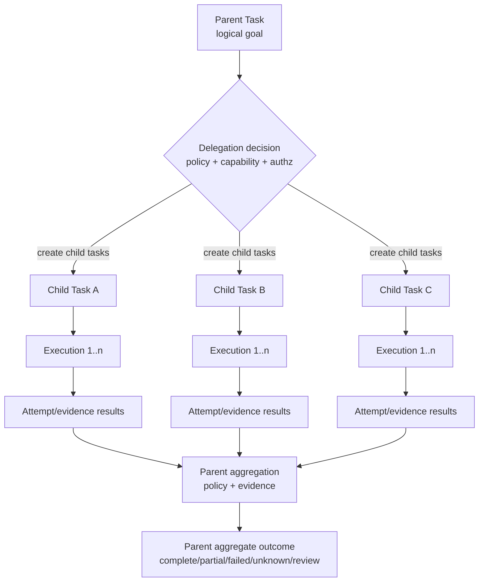
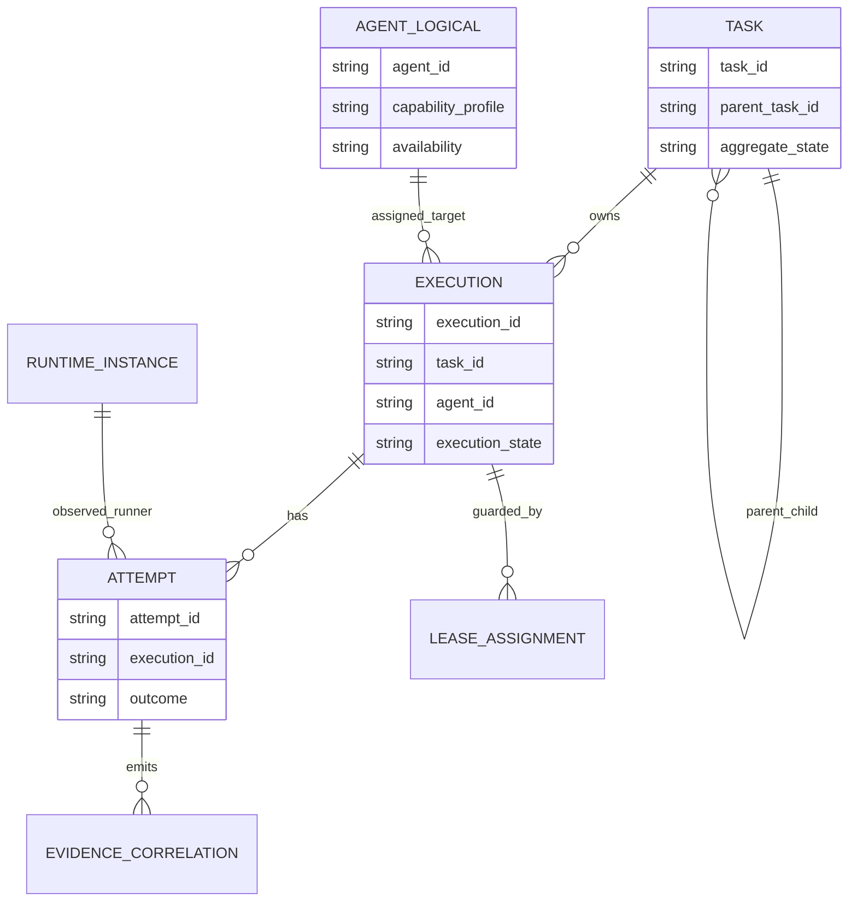
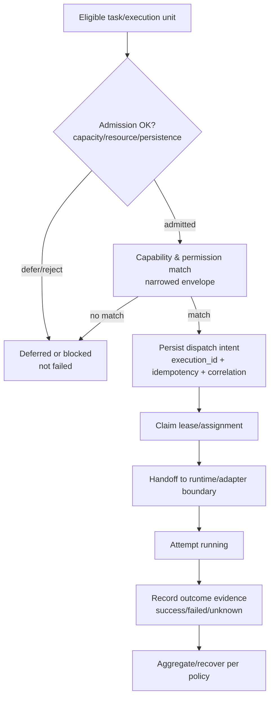
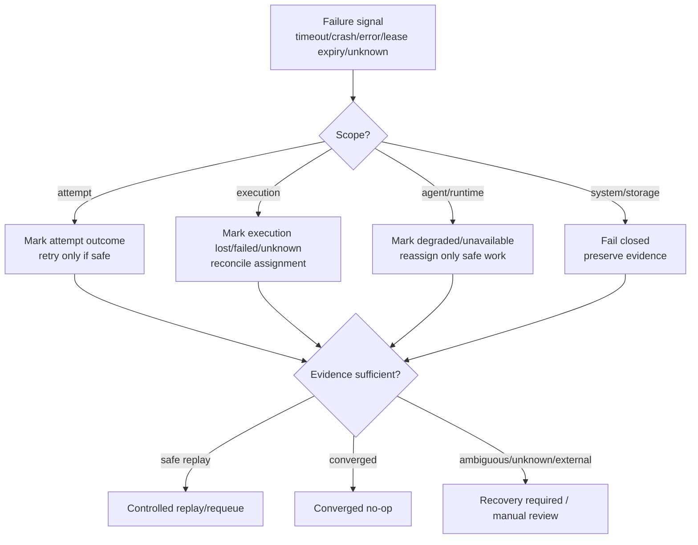
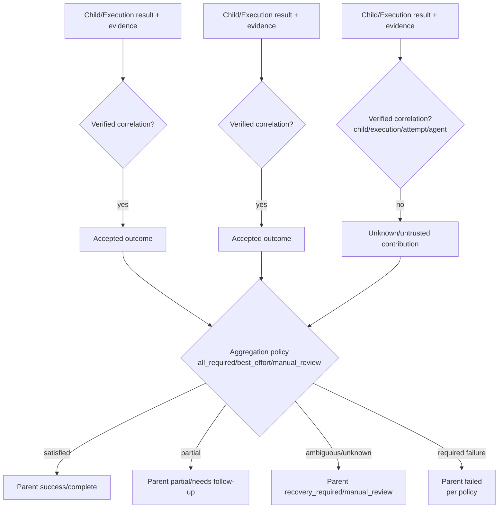

# 11 — Proposed Sub-Agent & Execution Orchestration Architecture (Stage 5A.3)

**Status:** **PROPOSED / NOT IMPLEMENTED / NOT APPROVED.** Architecture audit/design only. No production code/schema/config/flag changes, no Hermes enablement/attachment/lifecycle actions, no real sub-agents/executions/experiments.  
**Inputs:** `00`–`10`, Stage 5A.1 domain model (`02`–`04`), Stage 5A.2 scheduler/admission architecture (`06`–`08`), 4B.3/4B.4/4B.5/4B.6 constraints.  
**Hard boundaries (must hold):** AJ remains orchestration/control plane (not execution runtime, not JARVIS personal memory, not HELIX internal project state, not Hermes skill registry, not universal shared DB). Hermes remains possible external runtime provider only (read-only `status.read` NOT ATTACHED, `gateway.ensure` unauthorized). JARVIS = personal assistant/coordinator; HELIX = advanced execution manager. `local_trust` ≠ authenticated identity. No exactly-once external side effects; no fabricated IDs/outcomes.

**All diagrams and models below are PROPOSED — NOT IMPLEMENTED — NOT APPROVED.**

---

## 1. Design principles and non-goals

- **Simplicity/minimalism:** prefer the simplest model that removes ambiguity; no distributed actor system/broker/DB/Docker/paid infra by default.
- **Explicit identity and separation:** distinct state/identity for Task, Operation (optional), Execution, Attempt, Agent (logical) vs runtime/worker instance, Lease/Assignment, Evidence/Correlation.
- **AJ owns orchestration truth:** task intent, delegation graph, admission/dispatch decisions, execution/attempt records, aggregation policy/evidence, and recovery classification (evidence-based).
- **External runtimes own runtime-internal execution:** process/session management, runtime-local scheduling/cancellation mechanics, and runtime-native IDs (if any) — exposed only as observed/correlated evidence.
- **Fail-closed and evidence-honest:** deny-by-default permissions, no unsafe replay of ambiguous external effects, durable intent before dispatch where safety requires, unknown outcomes explicit.
- **Compatibility:** align with 5A.2 pipeline (`Task → Eligibility → Admission → Execution Assignment/Dispatch → Execution/Attempt → Runtime → Evidence`) and 8 GB/NTFS constraints.

---

## 2. Proposed delegation model (foundation)

### 2.1 Models compared
| Model | Description | Strengths | Weaknesses |
|---|---|---|---|
| **A. Child task delegation** | Parent creates independent child Tasks. | Clear user/logical units, reuse existing task persistence/lifecycle, natural audit boundaries. | Aggregation/coordination overhead; more records; needs explicit parent-child semantics. |
| **B. Multiple executions under one Task** | One Task owns multiple concurrent Executions. | Efficient for fan-out of same logical work; fewer task records. | Risks conflating logical subwork with runtime attempts; harder result ownership/permissions/aggregation semantics. |
| **C. Hybrid (recommended)** | Parent Task may create child Tasks for logically distinct delegated work; each Task (child or leaf) may own 0..N Executions over time, and each Execution has 0..N Attempts. | Identity clarity, flexible fan-out (logical and execution-level), supports retries without redefining tasks, compatible with 5A.1/5A.2, isolates failure/permissions per child task. | More entities/relationships (but minimal set); requires clear aggregation rules. |

### 2.2 Recommendation (proposed)
**Adopt Model C (Hybrid)** as the foundation.
- **Child Task** = delegated logical subwork with its own goal/scope, permissions context (narrowed/inherited), dependencies, lifecycle, and evidence — created by parent/orchestrator when work is logically separable.
- **Execution** = one AJ-managed dispatch/assignment instance of task work to an agent/runtime slot (stable AJ identity, `execution_id`).
- **Attempt** = one concrete try of an execution (`attempt_id`), preserving retry lineage and outcome evidence.
- Simple cases: 1 task ↔ 1 execution ↔ 1..N sequential attempts. Fan-out: parent ↔ N child tasks and/or task ↔ N executions (bounded, policy-gated).

---

## 3. Proposed identity and domain entities (execution/agent-focused)

| Entity | AJ-owned? | Stable? | Purpose / key fields (proposed) |
|---|---|---|---|
| **Task** | Yes | Stable | Logical unit of work: `task_id`, `parent_task_id`, `root_task_id`, goal, requester, capability/intent, priority/deadline, deps, aggregate state/outcome, authz context (narrowed), evidence refs. |
| **Operation** (optional) | Yes | Stable | Scoped intent within task when needed (0..N/task); avoids overloading single `operation_id` for concurrent work. |
| **Execution** | Yes | Stable | Managed dispatch instance: `execution_id`, `task_id`(+`operation_id`), assigned logical `agent_id`/runtime target, execution state, dispatch/admission refs, lease/assignment refs, correlation refs. |
| **Attempt** | Yes | Stable | Concrete try: `attempt_id`, `execution_id`, attempt_no, start/end, outcome (`succeeded/failed/cancelled/timed_out/unknown/abandoned`), error/evidence refs, external correlation refs. |
| **Agent (logical)** | Yes (registry metadata) | Stable | Capability/profile record: logical `agent_id`/name, kind (internal/jarvis/helix/hermes/future), declared capabilities, availability policy, trust/permission ceiling, resource class, default limits. Not a live process. |
| **Runtime/worker instance (ephemeral)** | Partly (observed) | Transient but recordable | Actual executor holder (pid/process/thread/remote session handle) recorded as evidence/heartbeat metadata; may change across restarts. |
| **Assignment / dispatch intent** | Yes | Durable record/event | Links eligible+admitted work to an execution/agent slot before runtime handoff; includes idempotency/dispatch key and preconditions snapshot. |
| **Lease** | Yes | Durable/expirable | Coordination/ownership guard (execution/operation/mutation scopes) with holder, TTL/heartbeat, expiry semantics. |
| **Dependency edge** | Yes | Stable | Typed relation (task/op/execution) with satisfaction state and policy impact. |
| **Evidence / correlation** | Yes (AJ evidence), observed (external) | Durable append-only | Journal, receipts, op-evidence, admission/dispatch events; external runtime IDs/state mapped via correlation refs, never fabricated. |

**Critical distinctions (must remain explicit):** Agent identity ≠ Execution identity ≠ Process ID ≠ Runtime ID ≠ Task identity. One agent may execute many tasks/executions over time; one task may have multiple executions/attempts; one external runtime may host multiple executions.

---

## 4. Proposed lifecycles (separate state machines)

**Do not use one state machine for Task, Execution, Attempt, and Agent.**

| Concept | Proposed lifecycle states (indicative) | Notes |
|---|---|---|
| **Task (aggregate)** | `received/created → planned → authorized → blocked/waiting → active → completing → completed|failed|cancelled|rejected|dead_letter|recovery_required|unknown` | Aggregate outcome derived from required child tasks/executions per policy; never assume child success from dispatch. |
| **Execution (AJ-managed instance)** | `pending → eligible → admitted → dispatch_recorded → assigned → starting → running → verifying → succeeded|failed|cancelled|timed_out|lost|unknown|recovery_required` | `unknown/lost` required for ambiguity; transitions evidence-backed. |
| **Attempt** | `created → started → running → succeeded|failed|cancelled|timed_out|abandoned|unknown` | New retry = new attempt (and/or new execution dispatch per policy). Immutable outcome evidence preferred. |
| **Agent (logical/profile)** | `registered/known → available|degraded|unavailable|disabled|unknown` | Availability is policy/observation state, not proof of runtime health. Capacity tracked separately. |
| **Assignment/lease** | `requested/recorded → active → released|expired|revoked|stale` | Ownership/coordination, not execution success. |

(Exact state names/transitions to be finalized with 5A.1 model; proposals must stay consistent with existing task transition rigor and fail-closed recovery.)

---

## 5. Assignment flow and capability matching (proposed)

### 5.1 Flow (conceptual)
1. **Create/plan task** (and child tasks if delegated logical work) with explicit scope, deps, required capabilities, and narrowed authz context.
2. **Eligibility**: task/execution unit ready (deps satisfied, authz valid, not cancelled/held).
3. **Admission** (5A.2): capacity/resource/persistence/safety gates satisfied; durable admission decision recorded.
4. **Capability/agent matching**: select logical agent/runtime satisfying required capability set, availability, permission ceiling, and resource class/capacity constraints.
5. **Dispatch intent persisted**: record `execution_id`/attempt intent, assignment target, idempotency key, correlation context (durable before handoff when required).
6. **Lease/assignment claimed**: acquire execution ownership (AJ lease/assignment) for the specific execution instance.
7. **Runtime handoff**: invoke adapter/port with bounded request; capture returned/observed evidence and external correlation IDs if honestly provided.
8. **Progress/outcome recorded**: append-only events/receipts; update execution/attempt/task aggregate per evidence.
9. **Recovery/reconciliation**: on timeout/crash/ambiguity, classify and converge conservatively.

### 5.2 Capability matching rules (fail-closed)
- Agent/runtime must explicitly declare/support all required capabilities for the execution; missing/unknown capability ⇒ **no assignment** (defer or fail per policy).
- Unavailable/disabled capability ⇒ ineligible/deferred (not success).
- Incorrect/misleading advertisement ⇒ treat as untrusted until verified; execution outcomes still evidence-gated.
- **Delegation narrowing:** child/execution may receive only capabilities ⊆ (parent-authorized ∩ requester-authorized ∩ policy-allowed ∩ agent-supported). Parent cannot delegate capabilities it does not possess/authorize.
- Required capability absent in ecosystem ⇒ task/execution blocked/manual-review with explicit reason.

---

## 6. Permission inheritance and security (proposed)

- **Default:** inherit by **intersection/narrowing**, never amplification. Child task/execution receives explicit, minimal permission envelope derived from parent/requester/policy/capability requirements.
- **No implicit escalation:** sensitive capabilities (filesystem/network/messaging/lifecycle/external side effects) require explicit grants/approvals per policy; child-specific restrictions may further reduce scope.
- **Agent/runtime scope:** logical agent profile defines max ceiling; runtime adapter enforces boundary; AJ records requested vs granted scope in evidence.
- **Provenance:** every delegated action/execution must correlate `task_id/parent_task_id/execution_id/attempt_id/agent_id` and (if applicable) external runtime refs; audit records must remain redaction-safe.
- **Trust/authentication limits (current truth):** AJ can enforce local policy, declared capability/permission checks, and evidence correlation; it **cannot** guarantee authenticated remote principal/agent identity or cryptographic provenance without future infrastructure. `local_trust` remains non-authenticated.

---

## 7. Monitoring and supervision (proposed)

| Question AJ must answer (future) | Durable facts (AJ-owned/evidence) | Process-local observations | External runtime observations |
|---|---|---|---|
| What agents exist/available? | Registry/profile records, config, availability decisions | Probe results (transient) | Runtime status endpoints/reports (if any) |
| Which tasks/executions assigned/running? | Task/execution/attempt states, dispatch/assignment records, leases | Thread/process liveness (transient) | Runtime session/state IDs if observed |
| Who owns each execution? | `execution_id` ↔ `agent_id` ↔ assignment/lease holder | worker pid/host (transient evidence) | runtime owner/session if reported |
| Progress/stalled/disappeared? | Timestamps, heartbeats recorded, receipts/events | in-memory timers/health checks | runtime progress signals |
| Blocking/aggregation/outstanding results? | Dependency graph, child/execution outcome records, aggregation state | none | none authoritative |
| Recovery required/manual review? | Recovery assessments, unknown outcomes, invariant/consistency findings | none | external completion reports reconciled as evidence |

**Rule:** transient observations inform decisions/events but are never treated as durable truth without persisted evidence.

---

## 8. Result aggregation (proposed)

### 8.1 Aggregation policies (conceptual support)
- **Initial (recommended):** `all_required` (default for critical fan-out), `best_effort` (explicit), and `manual_review` on partial/unknown outcomes.
- **Deferred:** `any_one_sufficient`, `quorum`, weighted/optimized aggregation (require explicit policy and conflict-resolution semantics).

### 8.2 Rules
- Parent **never** marked successful because children/executions were launched/dispatched.
- Child/execution completion counts only with verifiable evidence correlated to `child task_id`, `execution_id`, `attempt_id`, assigned `agent_id`, and outcome/evidence records.
- **Partial success:** aggregate state must reflect per-child outcomes (e.g. `completed_with_failures`, `blocked`, `recovery_required`, `unknown`) per explicit policy.
- **Unknown/ambiguous child outcome:** blocks automatic parent success; may require manual review or bounded compensating policy (no unsafe assumptions).

---

## 9. Cancellation model (proposed)

| Scope | Meaning | Expected behavior |
|---|---|---|
| Cancel attempt | Stop one concrete try | Mark attempt `cancel_requested/cancelled/unknown`; do not imply execution/task cancelled unless scoped. |
| Cancel execution | Stop one AJ-managed execution instance | Revoke/close assignment/lease as applicable; request runtime cancellation if supported; record outcome honestly. |
| Cancel child task | Cancel one delegated logical unit | May cascade to its executions per policy; siblings unaffected. |
| Cancel parent task | Cancel parent scope | Policy decides cascade to descendants/executions; must be explicit and evidence-backed. |
| Agent/runtime shutdown | Operational action | Out of AJ control except via authorized runtime capabilities; never assumed. |

**States to distinguish:** `cancellation_requested`, `local_cancellation_completed`, `external_cancellation_confirmed` (only with evidence), `cancellation_outcome_unknown`. **Never claim local process termination proves external operation stopped.** Unknown confirmation ⇒ `unknown/recovery_required/manual_review`.

---

## 10. Failure isolation and recovery (proposed)

- **Failure scopes:** attempt-scoped, execution-scoped, task-scoped, agent/runtime-scoped (capacity/availability), system-scoped (persistence/storage). Contain blast radius by scope + budgets (5A.2).
- **Isolation:** one child/execution/agent failure must not corrupt unrelated tasks/siblings; shared-state writes must be validated and evidence-linked.
- **Retry scope:** retry at attempt/execution level only when policy and evidence mark safe (idempotent/replay-safe); external side effects default to **no automatic retry** on ambiguity.
- **Recovery:** evidence-based classification (`replay_safe`, `converged`, `blocked`, `recovery_required`, `manual_review`, `unknown`); reconcile leases/dispatch intents/attempt outcomes; prefer convergence over replay.
- **Manual review triggers:** unknown external outcome, conflicting/insufficient evidence, persistence uncertainty, suspected duplicate side effects, permission/provenance ambiguity.

---

## 11. Orphan and stuck execution detection (proposed)

| Condition | Detection signal (durable/transient) | Classification/response |
|---|---|---|
| Task exists but no execution/dispatch (when expected) | Task state vs missing execution/dispatch records | Re-evaluate eligibility/admission; create dispatch intent only via controlled path. |
| Execution exists but agent/worker disappeared | Missing heartbeat/lease expiry + no outcome evidence | Mark `lost/unknown` or recovery-required; do not auto-assume failure/success. |
| Lease expired while execution may still run | Lease `expired` with active/unknown attempt | Ownership uncertainty; no mutation authority from expiry; require reconciliation. |
| Process exists but AJ lost record | OS observation vs missing AJ evidence | Treat AJ record as source of truth gap; investigate/manual review; do not fabricate. |
| Running indefinitely | Exceeded timeout/heartbeat SLA | Timeout execution/attempt; outcome may be unknown if no confirmed stop. |
| External result arrives after local unknown | Late correlation event/receipt | Reconcile evidence, update outcome if verifiable, preserve audit trail. |
| Duplicate execution/dispatch detected | Same idempotency/dispatch key or conflicting active claims | Quarantine/reconcile; prevent unsafe duplicate side effects. |

All detection must separate observed signals from confirmed outcomes; automated retry only when provably safe.

---

## 12. Interaction with Stage 5A.2 scheduler/admission (consistency)

- **Single decision ownership (proposed):** Eligibility evaluator decides readiness; **Admission controller** decides capacity/resource/persistence safety; **Scheduler/dispatcher** selects admitted work and records dispatch intent; **Execution assignment** binds `execution_id` to logical agent/slot under lease; **Worker/runtime boundary** executes attempts and reports evidence.
- Agent layer **consumes** admission/dispatch authorization; it must not make independent conflicting admission decisions.
- Respects 5A.2 global/scoped/per-agent/per-capability/resource-class limits, backpressure, parent/child limits, and retry limits. Waiting for capacity/agent availability remains deferred (not failed).

---

## 13. Future Hermes interaction (architecture analysis only; not implemented)

| Topic | Proposed boundary (AJ vs Hermes) |
|---|---|
| Ownership | **AJ owns:** task/delegation/eligibility/admission/dispatch intent, AJ `execution_id/attempt_id`, permission narrowing, aggregation, recovery decisions, canonical evidence/correlation. **Hermes owns (if/when integrated):** runtime-internal execution/session/process behavior and any native runtime IDs/state it truthfully exposes. |
| IDs/evidence crossing boundary | AJ sends bounded request context/correlation keys; Hermes may return observed runtime/session/request IDs, status, outputs, errors — recorded only as correlated evidence (never fabricated, never primary AJ identity). |
| Capability/permission mapping | AJ maps AJ capability/permission envelope to allowed Hermes invocation scope via explicit adapter contract/feature flags; deny-by-default. |
| Cancellation/unknown outcomes | AJ may request cancellation only through authorized capability contract; result classified as requested/completed-locally/externally-confirmed/unknown based on evidence. Connectivity loss or late completion ⇒ `unknown` then reconcile on evidence. |
| Retries/side effects | No assumption of Hermes idempotency/exactly-once/cancellation guarantees unless source-verified; ambiguous external effects are non-retryable by default. |
| Unavailable Hermes | Treat as capability/runtime unavailable → ineligible/deferred/failed per policy; AJ remains functional for local/internal paths; integration stays NOT ATTACHED unless separately authorized. |

---

## 14. Future JARVIS/HELIX interaction (orchestration contracts only)

- **JARVIS:** may originate/delegate user-level goals/requests to AJ; AJ returns accountable task/execution status and evidence without absorbing JARVIS personal memory/preferences.
- **HELIX:** may be a target execution manager/runtime (future) for complex engineering work; AJ coordinates delegation/assignment/evidence boundaries without owning HELIX internal project/task state.
- Contracts limited to: request/intent submission, capability/permission-scoped delegation, status/progress/result/evidence reporting, cancellation/recovery signals — all explicit and auditable. No shared canonical DB across projects.

---

## 15. Architecture alternatives (>=4) and recommendation

| Option | Description | Isolation | Reliability | Memory/startup | Failure containment | Security | Observability | Cancellation | Resource accounting | Persistence | Future Hermes fit | Future JARVIS/HELIX fit | Complexity (8 GB) |
|---|---|---|---|---|---|---|---|---|---|---|---|---|---|
| **A. In-process logical sub-agents** | Agents/executions are in-process logical workers/adapters managed by AJ | Low | Moderate (SPOF process) | Low/Low | Low–moderate | Simple boundary but shared process | Easy local introspection | Limited (cooperative only) | Coarse | Simple local stores | Adapter-based possible | Easy logical integration | Low |
| **B. Process-isolated local agents** | Each agent/execution in separate local process | High (OS) | Better isolation, more failure modes | Higher/Higher | Good | Stronger isolation, more IPC surface | Harder cross-process tracing | Better (process signals) but external ambiguity remains | Better per-process | Needs robust IPC/claim persistence | Possible but heavy | Possible | High on 8 GB |
| **C. Runtime-backed agents** | AJ delegates execution to Hermes/other controlled runtime adapters | Depends on runtime | Depends on runtime + boundary evidence | Externalized/runtime-dependent | Good if boundaries clear | Depends on runtime/authz; AJ must fail closed | Requires correlation contracts | Runtime-dependent/uncertain | Runtime-dependent | Dual evidence sources | **Direct fit** (when authorized) | Possible via adapters | Medium (integration risk) |
| **D. Hybrid staged architecture (recommended)** | AJ owns canonical orchestration state (task/execution/attempt/assignment/evidence); execution runs behind stable adapter boundary: start with in-process logical workers (A), add supervised worker management, and integrate runtime-backed/process-isolated executors only for specific classes when evidenced/authorized | Progressive (low→higher as needed) | Incremental; fail-closed/evidence-first | Low initially | Improves by stage | Preserves AJ boundaries, least privilege per adapter | Unified AJ evidence model + correlated runtime signals | Explicit per-scope semantics, honest unknowns | Class/budget-based from 5A.2 | Reuses append-only stores + dispatch/assignment records | **Best staged fit** (Hermes optional, gated) | Preserves separate identities/contracts | **Best fit for 8 GB** (conservative) |

**Recommendation (proposed, not approved): Option D — Hybrid staged architecture.**  
Rationale: aligns with 5A.1/5A.2 foundations, current in-process reality, 8 GB/NTFS constraints, and strict AJ/JARVIS/HELIX/Hermes boundaries. It delivers unambiguous identities (Model C + `execution_id`/`attempt_id`), admission/assignment integration, and evidence-honest recovery without premature process/runtime complexity. Runtime-backed Hermes and stronger isolation remain gated, optional future stages.

---

## 16. Mermaid diagrams (PROPOSED — NOT IMPLEMENTED — NOT APPROVED)

### 16.1 Parent → child delegation (PROPOSED — NOT IMPLEMENTED — NOT APPROVED)

### 16.2 Task → execution → agent relationship (PROPOSED — NOT IMPLEMENTED — NOT APPROVED)

### 16.3 Assignment flow (PROPOSED — NOT IMPLEMENTED — NOT APPROVED)

### 16.4 Failure/recovery flow (PROPOSED — NOT IMPLEMENTED — NOT APPROVED)

### 16.5 Result aggregation (PROPOSED — NOT IMPLEMENTED — NOT APPROVED)

---

## 17. Open limitations (design-level, carried forward)
- `execution_id`/attempt/execution persistence model and store evolution not yet specified/implemented (depends on 5A.4 and approvals).
- Numeric capacity/timeout/heartbeat defaults unverified for 8 GB/NTFS environment.
- External runtime contracts (Hermes/JARVIS/HELIX) for IDs, cancellation, progress, and idempotency remain unproven/unauthorized.
- Cross-store atomicity and NTFS/SQLite reliability remain unresolved risks; all dispatch/aggregation must be evidence-honest and fail-closed.
MARKDOWN
